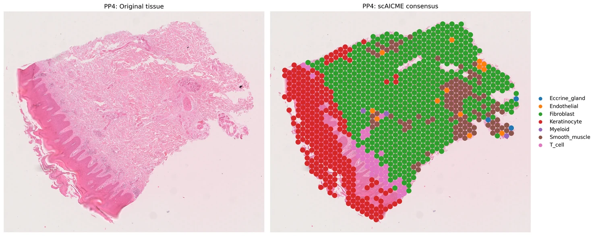

# scAICME

**Adaptive Marker-Guided Semi-Supervised Framework for Single-Cell RNA-seq and Spatial Transcriptomics Data Analysis**

Snehalika Lall and Adityarup Laha (equal contribution), Jayant Jha, Sanghamitra Bandyopadhyay and Raghunath Chatterjee · Indian Statistical Institute, Kolkata.

[Project page](https://snehalikalall.github.io/scAICME/) · [Data and accessions](data/README.md) · [Analysis notebooks](notebooks/README.md) · [Results and provenance](results/README.md)

scAICME uses expression of tissue-specific markers to select seed labels, then trains classifiers on the seeds and records their agreement for each cell or spatial spot. In a Visium section, the label describes the predominant expression signal in a spot that can contain multiple cells.



*Psoriatic skin, GSE225475. The manuscript pairs the tissue image with the spatial distribution of consensus labels. The [full-resolution figure](results/figures/Skin_original_vs_label_consensus.png) is available with the other results.*

## Start here

To inspect the saved spatial results, run this command from the repository root with Python 3. It reads the included CSVs and requires only the standard library.

```bash
python scripts/show_spatial_results.py
```

To run an analysis, use a separate Python environment and prepare the inputs for one tissue. The data guide gives the archive accession, expected local layout and required reference files for each notebook.

```bash
conda create -n scaicme-notebooks python=3.11 pip -y
conda activate scaicme-notebooks
python -m pip install -r requirements.txt
python -m jupyter lab
```

Open one of the notebooks below and run the cells in order from a fresh kernel. Each notebook writes to its own directory under `results/runs/`. Optional comparison cells have a switch in the first code cell and use additional packages listed in the [notebook guide](notebooks/README.md).

| Dataset | Single-cell RNA-seq | Spatial transcriptomics |
| --- | --- | --- |
| PBMC 68K | [10x PBMC 68K](notebooks/single_cell/pbmc68k.ipynb) | — |
| Breast | [GSE161529](notebooks/single_cell/breast_gse161529.ipynb) | [GSE243022](notebooks/spatial/breast_gse243022.ipynb) |
| Lung | [GSE127465](notebooks/single_cell/lung_gse127465.ipynb) | [GSE292299](notebooks/spatial/lung_gse292299.ipynb) |
| Oral | [GSE215403](notebooks/single_cell/oral_gse215403.ipynb) | [GSE208253](notebooks/spatial/oral_gse208253.ipynb) |
| Skin | [Study record](https://www.ncbi.nlm.nih.gov/geo/query/acc.cgi?acc=GSE173706) | [GSE225475](notebooks/spatial/skin_gse225475.ipynb) |

The manuscript also describes PBMC CITE-seq, bone marrow and retina. The [dataset manifest](data/datasets.tsv) covers all twelve study datasets and identifies the eight with supplied notebooks.

## Interpreting this release

These eight notebooks implement the authors’ tissue-specific analyses. They contain an earlier consensus implementation. For example, the PBMC notebook takes a plurality over five classifier outputs and records agreement. The manuscript describes a six-classifier, two-thirds agreement rule and a lineage-then-subtype procedure. The code for that later benchmark was outside the supplied files.

The [results guide](results/README.md) distinguishes notebook output from manuscript transcriptions. The four scAICME spatial metric rows agree across those sources. Some comparator values and two spot counts differ. The guide records the differences alongside the original figures. Local reruns and their outputs belong under `results/runs/`.

## Citation

Lall S, Laha A, Jha J, Bandyopadhyay S, Chatterjee R. *scAICME: Adaptive Marker-Guided Semi-Supervised Framework for Single-Cell RNA-seq and Spatial Transcriptomics Data Analysis*. Manuscript. The repository citation is also available in [CITATION.cff](CITATION.cff).
